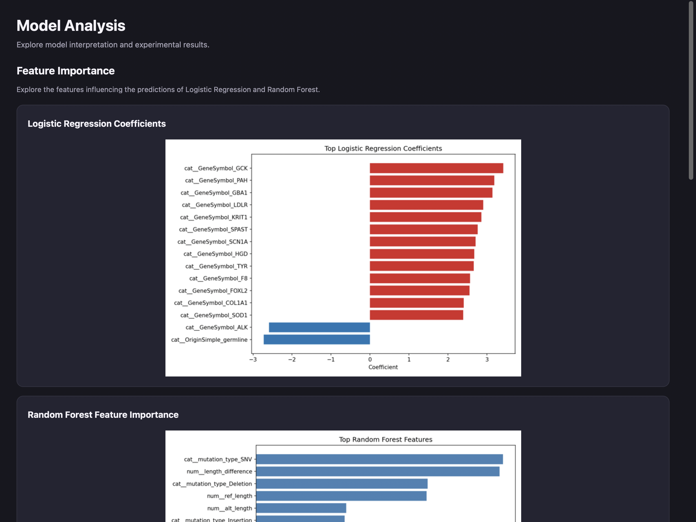
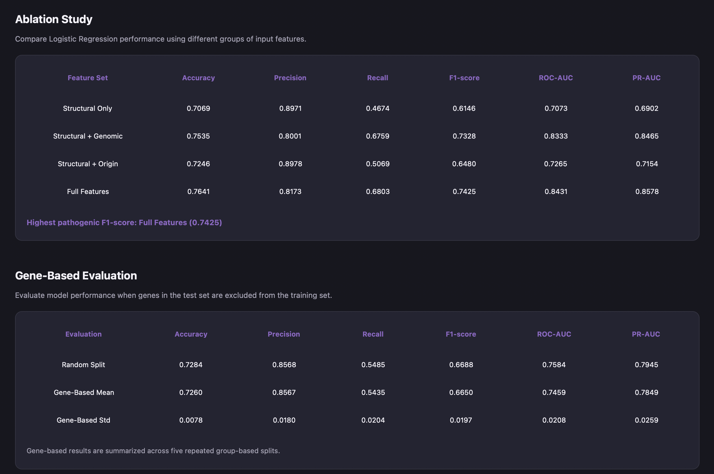
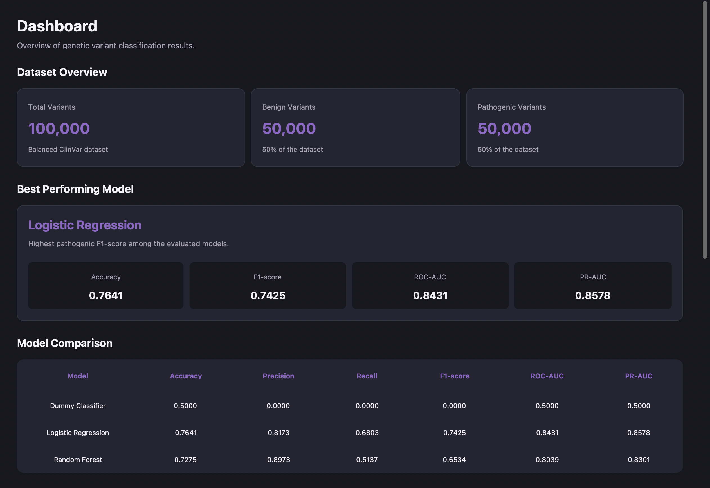
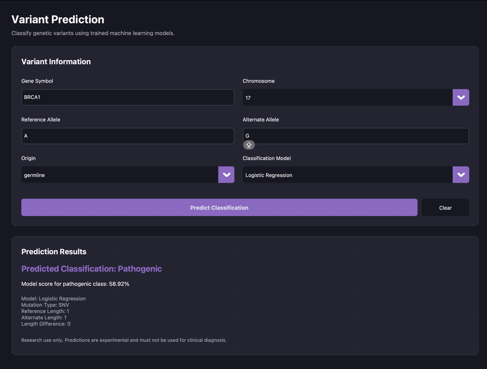

# Genetic Variant Classification Using ClinVar

Machine learning classification of genetic variants using benign and pathogenic labels from ClinVar.

This project includes a Python pipeline for preprocessing, training, and evaluating classification models, along with a CustomTkinter desktop application for exploring predictions and results. The experiments examine feature contributions and performance on variants from genes excluded during training.

> **Research use only.** The models have not been clinically validated. Predictions and scores must not be used for diagnosis, treatment, or clinical variant interpretation.

## Contents

- [Overview](#overview)
- [Dataset and features](#dataset-and-features)
- [Model evaluation](#model-evaluation)
- [Experimental analysis](#experimental-analysis)
- [Desktop application](#desktop-application)
- [Project structure](#project-structure)
- [Installation and usage](#installation-and-usage)
- [Notebooks](#notebooks)
- [Limitations and future work](#limitations-and-future-work)

## Overview

The project asks how well common machine learning models reproduce ClinVar classification labels using a limited set of genomic and structural features. It also examines which feature groups affect performance and how results change when test genes are excluded from training.

Three models were evaluated: a Dummy Classifier baseline, Logistic Regression, and Random Forest. Logistic Regression achieved the highest F1-score in the main evaluation; Random Forest had higher precision but lower recall for the pathogenic class.

```text
ClinVar variant_summary.txt
           |
           v
  Filtering and deduplication
           |
           v
     Feature engineering
           |
           v
  Balanced sample (100,000)
           |
           v
     Model training
           |
           v
     Model evaluation
           |
           +---------------------+
           |                     |
           v                     v
  Experimental analysis    Desktop application
```

## Dataset and features

### Data source and preparation

The pipeline reads ClinVar's `variant_summary.txt` file, selects records associated with the GRCh38 reference assembly, and maps four clinical significance labels to two classes:

| ClinVar label | Target |
|---|---:|
| Benign | 0 |
| Likely benign | 0 |
| Pathogenic | 1 |
| Likely pathogenic | 1 |

Other clinical significance categories are excluded. Processing is performed in chunks to reduce memory use. Variants are identified by chromosome, genomic position, reference allele, and alternate allele; the pipeline also removes duplicates and checks for conflicting classifications.

The preprocessing analysis identified **1,598,540 unique eligible variants** before sampling. The final dataset contains **100,000 variants**, with 50,000 in each class. This balance was introduced for experimentation and does not represent pathogenic-variant prevalence in clinical populations.

The processed file is saved to `data/processed/clinvar_features.csv`. Raw and processed datasets are stored locally rather than in the repository.

### Input features

| Feature | Type | Description |
|---|---|---|
| `Chromosome` | Categorical | Chromosome containing the variant |
| `GeneSymbol` | Categorical | Associated gene |
| `mutation_type` | Categorical | SNV, insertion, deletion, or other |
| `OriginSimple` | Categorical | Variant-origin metadata |
| `ref_length` | Numerical | Reference allele length |
| `alt_length` | Numerical | Alternate allele length |
| `length_difference` | Numerical | Alternate minus reference allele length |

Mutation type and allele-length features are derived from the reference and alternate alleles. `ReviewStatus` is excluded from the predictors to reduce reliance on ClinVar review metadata.

The models do not use population allele frequencies, conservation scores, functional annotations, or predicted protein-level effects.

## Model evaluation

Categorical variables are encoded using `OneHotEncoder`; numerical variables pass through the preprocessing pipeline. Logistic Regression and Random Forest use balanced class weights. The balanced dataset is divided into **80,000 training** and **20,000 test** variants using a stratified 80/20 split.

Precision, recall, and F1-score refer to the pathogenic class.

| Model | Accuracy | Precision | Recall | F1-score | ROC-AUC | PR-AUC |
|---|---:|---:|---:|---:|---:|---:|
| Dummy Classifier | 0.5000 | 0.0000 | 0.0000 | 0.0000 | 0.5000 | 0.5000 |
| **Logistic Regression** | **0.7641** | 0.8173 | **0.6803** | **0.7425** | **0.8431** | **0.8578** |
| Random Forest | 0.7275 | **0.8973** | 0.5137 | 0.6534 | 0.8039 | 0.8301 |

Logistic Regression achieved the highest F1-score (0.7425). Random Forest's higher precision (0.8973) came with lower recall (0.5137), meaning it missed more variants labeled as pathogenic. Logistic Regression was therefore selected as the primary model for this dataset and evaluation setup.

The evaluation generates confusion matrices, ROC curves, and Precision–Recall curves in `results/figures/`.

## Experimental analysis

### Feature importance

Logistic Regression coefficients describe associations between encoded predictors and the model's predicted log-odds. Random Forest impurity-based importance measures how much features contribute to tree splitting decisions. Neither method establishes biological causality; interpretation is affected by encoding, correlated predictors, and, for impurity-based importance, feature cardinality.



### Ablation study

Four feature configurations were evaluated using Logistic Regression:

| Feature set | Accuracy | Precision | Recall | F1-score | ROC-AUC | PR-AUC |
|---|---:|---:|---:|---:|---:|---:|
| Structural Only | 0.7069 | 0.8971 | 0.4674 | 0.6146 | 0.7073 | 0.6902 |
| Structural + Genomic | 0.7535 | 0.8001 | 0.6759 | 0.7328 | 0.8333 | 0.8465 |
| Structural + Origin | 0.7246 | 0.8978 | 0.5069 | 0.6480 | 0.7265 | 0.7154 |
| **Full Features** | **0.7641** | 0.8173 | **0.6803** | **0.7425** | **0.8431** | **0.8578** |

Adding genomic features to structural features increased F1-score from **0.6146 to 0.7328** and recall from **0.4674 to 0.6759**. The full feature set achieved the highest F1-score among the tested configurations. Origin metadata provided a smaller improvement when added to structural features alone.

### Gene-based evaluation

A random split can place variants from the same gene in both training and test sets. To examine performance on held-out genes, five experiments used `GroupShuffleSplit`, grouping records by gene symbol. `GeneSymbol` was excluded as a predictor in both the random-split baseline and gene-based experiments.

| Metric | Random split | Gene-based mean | Standard deviation |
|---|---:|---:|---:|
| Accuracy | 0.7284 | 0.7260 | 0.0078 |
| Precision | 0.8568 | 0.8567 | 0.0180 |
| Recall | 0.5485 | 0.5435 | 0.0204 |
| F1-score | 0.6688 | 0.6650 | 0.0197 |
| ROC-AUC | 0.7584 | 0.7459 | 0.0208 |
| PR-AUC | 0.7945 | 0.7849 | 0.0259 |

The mean and sample standard deviation summarize five repeated gene-based splits. Average F1-score was close to the random-split baseline (0.6650 versus 0.6688), but performance and class prevalence varied across test sets. Repeated `GroupShuffleSplit` test sets may overlap, so these are not independent cross-validation folds. The findings are preliminary and do not establish performance across all unseen genes.



## Desktop application

The CustomTkinter application has three pages. It uses trained models and evaluation files generated by the pipeline.

### Dashboard

The Dashboard summarizes the balanced dataset, compares model metrics, and displays ROC and Precision–Recall curves.



### Variant Prediction

Users can enter a gene symbol, chromosome, reference and alternate alleles, and variant origin, then select Logistic Regression or Random Forest. The application derives structural features and returns a predicted class and a model-generated score.



The score reflects patterns learned from the training data. **It is not a clinically calibrated probability of pathogenicity.**

### Model Analysis

The Model Analysis page presents Logistic Regression coefficients, Random Forest feature importance, ablation results, and random versus gene-based evaluation. Examples appear in the [experimental analysis](#experimental-analysis) section above.

Launch the application from the project root:

```bash
python -m app.main
```

## Project structure

```text
genetic-variant-classification/
├── app/                 # CustomTkinter interface
├── data/
│   ├── raw/             # Downloaded ClinVar file (local)
│   └── processed/       # Generated training dataset (local)
├── notebooks/
│   ├── 01_data_exploration.ipynb
│   ├── 02_model_evaluation.ipynb
│   └── 03_experimental_analysis.ipynb
├── src/                 # Preprocessing, training and experiments
├── models/              # Trained models (generated locally)
├── results/
│   ├── figures/
│   └── metrics/
├── reports/
│   └── screenshots/     # Application screenshots used in this README
├── requirements.txt
└── README.md
```

## Installation and usage

### 1. Clone and set up the environment

```bash
git clone https://github.com/blagaalexandramaria/genetic-variant-classification-.git
cd genetic-variant-classification-
python3 -m venv .venv
```

Activate the environment on macOS or Linux:

```bash
source .venv/bin/activate
```

On Windows (PowerShell):

```powershell
.venv\Scripts\Activate.ps1
```

Install dependencies:

```bash
python -m pip install -r requirements.txt
```

### 2. Prepare the data

Download ClinVar's `variant_summary.txt` from NCBI and save it as `data/raw/variant_summary.txt`.

To test preprocessing on a smaller input:

```bash
python -m src.preprocessing --mode dev --nrows 10000
```

To generate the balanced experimental dataset:

```bash
python -m src.preprocessing --mode balanced-sample --samples-per-class 50000
```

Both modes write `data/processed/clinvar_features.csv`.

### 3. Run the experiments

```bash
python -m src.train
python -m src.evaluate
python -m src.ablation
python -m src.gene_split_evaluation
```

The scripts generate model files, metrics, and figures. Key result files include:

```text
results/metrics/model_comparison.csv
results/metrics/ablation_study.csv
results/metrics/gene_split_comparison.csv
results/metrics/gene_split_summary.csv
```

### 4. Open the application or notebooks

```bash
python -m app.main
```

```bash
jupyter notebook
```

## Notebooks

| Notebook | Contents |
|---|---|
| `01_data_exploration.ipynb` | Class distribution, mutation types, chromosomes, genes, allele lengths, missing values, and duplicates |
| `02_model_evaluation.ipynb` | Metrics, confusion matrices, ROC and Precision–Recall curves, and model comparison |
| `03_experimental_analysis.ipynb` | Feature importance, ablation study, gene-based evaluation, performance variability, and test-set class distributions |

The notebooks analyze data and results generated by the pipeline rather than retraining the models.

## Limitations and future work

The models use a restricted feature representation and learn from ClinVar labels, which may reflect submission patterns and differences in available evidence. The balanced dataset changes class prevalence, so precision, PR-AUC, and model scores may behave differently on other datasets. Feature importance is descriptive rather than causal.

Gene-based evaluation was limited to five repeated splits, without an independent external dataset. The resulting predictions and scores have not been validated for clinical use.

Future work could include external validation, gene-level error analysis, probability calibration, and additional biological features such as population frequencies, conservation scores, and functional annotations. Permutation importance, SHAP, and sequence-based models are other possible extensions.

## Author

**Alexandra Blaga**  
Computer Science student.
